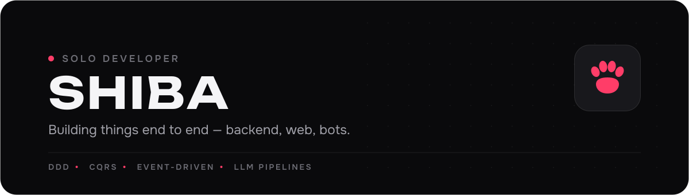
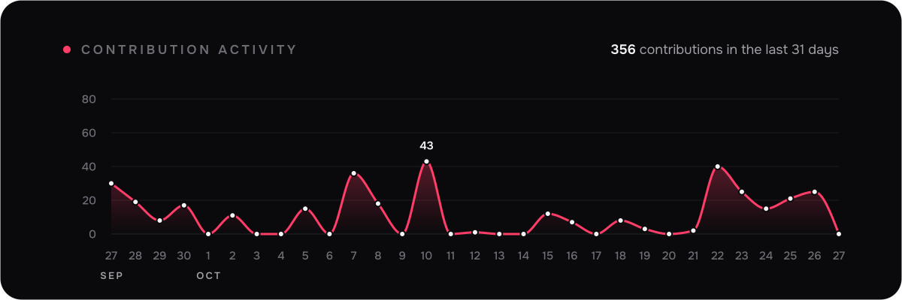

Solo developer. I ship products end to end: domain-driven NestJS backends (CQRS, event-driven pipelines on BullMQ), Next.js frontends, Telegram bots and Mini Apps — with LLM-powered features along the way.

### Activity

Most of the code lives in private product repos — the graph below is where it shows.

  

